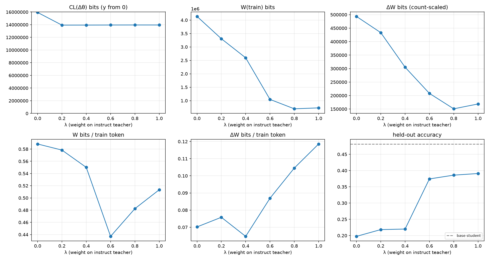
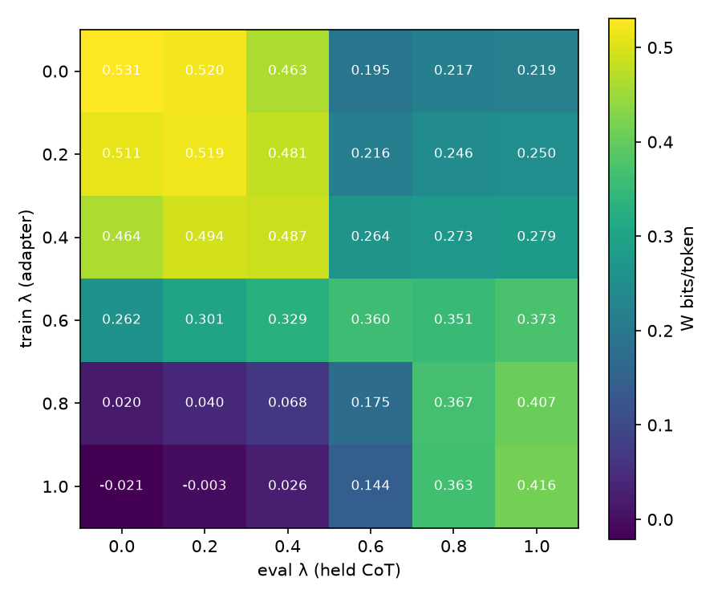

# λ sweep: LoRA bits of CoT distillation

Teacher pair: DeepSeek-R1-Distill-Qwen-1.5B (λ=0, Long CoT) ↔ Qwen2.5-Math-1.5B-Instruct (λ=1, Short CoT); student: Qwen2.5-0.5B-Instruct + LoRA (r=16, all linear layers).
Shared problems: 2561 (train 2261, held 300). Base student accuracy: held 0.482, MATH-500 —.

## Teacher CoT pools

| λ | teacher acc | truncated | avg teacher tokens | avg student tokens (kept) | train tokens |
|---|---|---|---|---|---|
| 0.0 | 0.675 | 0.305 | 4,788 | 3,198 | 7,029,975 |
| 0.2 | 0.77 | 0.207 | 4,200 | 3,070 | 5,716,353 |
| 0.4 | 0.848 | 0.122 | 3,603 | 2,883 | 4,718,438 |
| 0.6 | 0.896 | 0.0602 | 2,201 | 1,742 | 2,393,783 |
| 0.8 | 0.92 | 0.0352 | 1,594 | 1,271 | 1,442,926 |
| 1.0 | 0.911 | 0.0302 | 1,561 | 1,223 | 1,423,260 |

## Per-λ results (mean ± std over seeds)

| λ | seeds | held-out acc | MATH-500 acc | train tokens | dataset bits H | CL(Δθ) bits | step c* | CL bits/param | W(train) bits | W(held) bits | ΔW bits | ΔW token-scaled | W bits/token | ΔW bits/token | W/H |
|---|---|---|---|---|---|---|---|---|---|---|---|---|---|---|---|
| 0.0 | 1 | 0.198 | — | 7,029,975 | 10,994,745 | 15,933,236 | 1.25 | 1.81 | 4,135,846 | 483,287 | 493,472 | 402,259 | 0.588 | 0.0702 | 0.376 |
| 0.2 | 1 | 0.218 | — | 5,716,353 | 8,317,211 | 13,933,183 | 1.50 | 1.58 | 3,306,005 | 381,156 | 433,363 | 338,391 | 0.578 | 0.0758 | 0.397 |
| 0.4 | 1 | 0.22 | — | 4,718,438 | 6,245,132 | 13,938,522 | 1.50 | 1.58 | 2,595,387 | 303,875 | 305,183 | 296,881 | 0.55 | 0.0647 | 0.416 |
| 0.6 | 1 | 0.374 | — | 2,393,783 | 2,375,908 | 13,948,586 | 1.50 | 1.59 | 1,046,239 | 111,212 | 208,071 | 184,328 | 0.437 | 0.0869 | 0.44 |
| 0.8 | 1 | 0.386 | — | 1,442,926 | 1,337,451 | 13,954,801 | 1.50 | 1.59 | 696,106 | 72,349 | 150,834 | 166,340 | 0.482 | 0.105 | 0.52 |
| 1.0 | 1 | 0.391 | — | 1,423,260 | 1,381,467 | 13,952,399 | 1.50 | 1.59 | 730,621 | 74,552 | 168,745 | 138,385 | 0.513 | 0.119 | 0.529 |

## Cross-λ W (bits/token, seed 0): adapter trained on row λ, measured on column λ's held CoT

| train λ \ eval λ | 0.0 | 0.2 | 0.4 | 0.6 | 0.8 | 1.0 |
|---|---|---|---|---|---|---|
| 0.0 | 0.531 | 0.52 | 0.463 | 0.195 | 0.217 | 0.219 |
| 0.2 | 0.511 | 0.519 | 0.481 | 0.216 | 0.246 | 0.25 |
| 0.4 | 0.464 | 0.494 | 0.487 | 0.264 | 0.273 | 0.279 |
| 0.6 | 0.262 | 0.301 | 0.329 | 0.36 | 0.351 | 0.373 |
| 0.8 | 0.0197 | 0.0398 | 0.0682 | 0.175 | 0.367 | 0.407 |
| 1.0 | -0.0212 | -0.00291 | 0.0262 | 0.144 | 0.363 | 0.416 |

