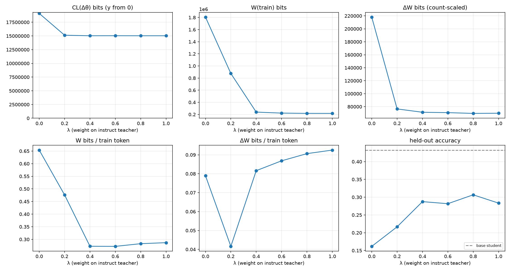
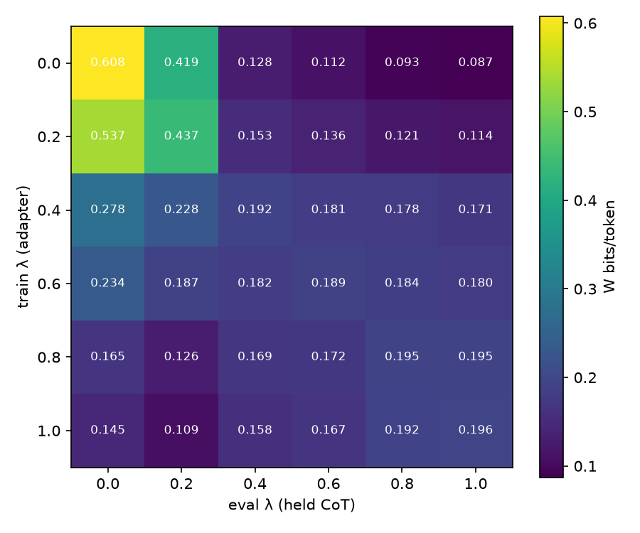

# λ sweep: LoRA bits of CoT distillation

Teacher pair: DeepSeek-R1-Distill-Qwen-1.5B (λ=0, Long CoT) ↔ Qwen2.5-Math-1.5B-Instruct (λ=1, Short CoT); student: Qwen2.5-0.5B-Instruct + LoRA (r=16, all linear layers).
Shared problems: 1940 (train 1640, held 300). Base student accuracy: held 0.432, MATH-500 —.

## Teacher CoT pools

| λ | teacher acc | truncated | avg teacher tokens | avg student tokens (kept) | train tokens |
|---|---|---|---|---|---|
| 0.0 | 0.855 | 0.098 | 2,932 | 2,282 | 3,013,070 |
| 0.2 | 0.873 | 0.032 | 1,887 | 1,506 | 1,938,819 |
| 0.4 | 0.821 | 0.0452 | 1,145 | 694.20 | 915,089 |
| 0.6 | 0.563 | 0.316 | 3,014 | 558.49 | 852,822 |
| 0.8 | 0.826 | 0.013 | 745.25 | 562.67 | 803,037 |
| 1.0 | 0.802 | 0.0315 | 836.70 | 533.63 | 789,730 |

## Per-λ results (mean ± std over seeds)

| λ | seeds | held-out acc | MATH-500 acc | train tokens | dataset bits H | CL(Δθ) bits | step c* | CL bits/param | W(train) bits | W(held) bits | ΔW bits | ΔW token-scaled | W bits/token | ΔW bits/token | W/H |
|---|---|---|---|---|---|---|---|---|---|---|---|---|---|---|---|
| 0.0 | 1 | 0.162 | — | 2,762,094 | 3,906,962 | 19,102,133 | 1.50 | 1.58 | 1,805,865 | 290,454 | 218,049 | 126,453 | 0.654 | 0.0789 | 0.462 |
| 0.2 | 1 | 0.217 | — | 1,839,458 | 1,681,218 | 15,128,936 | 2.00 | 1.25 | 875,738 | 146,200 | 76,509 | 71,785 | 0.476 | 0.0416 | 0.521 |
| 0.4 | 1 | 0.288 | — | 874,442 | 495,675 | 15,033,240 | 2.00 | 1.25 | 238,418 | 30,557 | 71,371 | 70,104 | 0.273 | 0.0816 | 0.481 |
| 0.6 | 1 | 0.282 | — | 815,155 | 432,616 | 15,038,596 | 2.00 | 1.25 | 221,909 | 27,645 | 70,785 | 68,124 | 0.272 | 0.0868 | 0.513 |
| 0.8 | 1 | 0.307 | — | 767,840 | 404,815 | 15,028,324 | 2.00 | 1.25 | 217,192 | 27,000 | 69,594 | 67,839 | 0.283 | 0.0906 | 0.537 |
| 1.0 | 1 | 0.283 | — | 755,491 | 397,969 | 15,029,611 | 2.00 | 1.25 | 216,756 | 26,865 | 69,892 | 68,447 | 0.287 | 0.0925 | 0.545 |

## Cross-λ W (bits/token, seed 0): adapter trained on row λ, measured on column λ's held CoT

| train λ \ eval λ | 0.0 | 0.2 | 0.4 | 0.6 | 0.8 | 1.0 |
|---|---|---|---|---|---|---|
| 0.0 | 0.608 | 0.419 | 0.128 | 0.112 | 0.0928 | 0.0869 |
| 0.2 | 0.537 | 0.437 | 0.153 | 0.136 | 0.121 | 0.114 |
| 0.4 | 0.278 | 0.228 | 0.192 | 0.181 | 0.178 | 0.171 |
| 0.6 | 0.234 | 0.187 | 0.182 | 0.189 | 0.184 | 0.18 |
| 0.8 | 0.165 | 0.126 | 0.169 | 0.172 | 0.195 | 0.195 |
| 1.0 | 0.145 | 0.109 | 0.158 | 0.167 | 0.192 | 0.196 |

