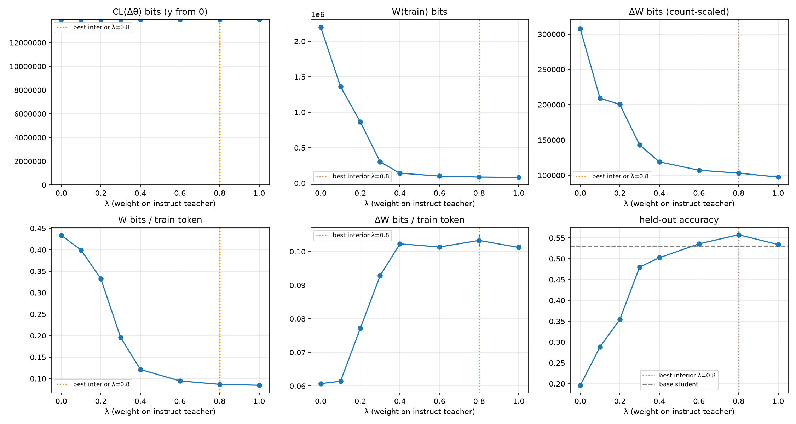
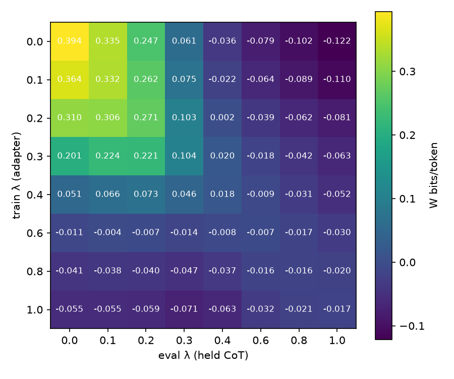

# λ sweep: LoRA bits of CoT distillation

Teacher pair: DeepSeek-R1-Distill-Qwen-1.5B (λ=0, Long CoT) ↔ Qwen2.5-Math-1.5B-Instruct (λ=1, Short CoT); student: Qwen2.5-0.5B-Instruct + LoRA (r=16, all linear layers).
Shared problems: 2413 (train 2113, held 300). Base student accuracy: held 0.531, MATH-500 0.318.
Best interior λ on held-out accuracy (seed 0): **0.8** (best overall: 0.8).

## Teacher CoT pools

| λ | teacher acc | truncated | avg teacher tokens | avg student tokens (kept) | train tokens |
|---|---|---|---|---|---|
| 0.0 | 0.765 | 0.185 | 3,851 | 2,747 | 5,070,016 |
| 0.1 | 0.81 | 0.107 | 2,826 | 1,996 | 3,405,736 |
| 0.2 | 0.813 | 0.071 | 2,231 | 1,535 | 2,599,187 |
| 0.3 | 0.807 | 0.0425 | 1,532 | 970.16 | 1,541,154 |
| 0.4 | 0.799 | 0.0355 | 1,117 | 673.66 | 1,164,398 |
| 0.6 | 0.794 | 0.0597 | 1,114 | 573.46 | 1,058,062 |
| 0.8 | 0.823 | 0.00725 | 680.45 | 545.38 | 998,917 |
| 1.0 | 0.815 | 0.0005 | 579.82 | 510.73 | 963,232 |

## Per-λ results (mean ± std over seeds)

| λ | seeds | held-out acc | MATH-500 acc | train tokens | dataset bits H | CL(Δθ) bits | step c* | CL bits/param | W(train) bits | W(held) bits | ΔW bits | ΔW token-scaled | W bits/token | ΔW bits/token | W/H |
|---|---|---|---|---|---|---|---|---|---|---|---|---|---|---|---|
| 0.0 | 3 | 0.196 | 0.128 ± 0.0015 | 5,070,016 | 5,840,134 | 13,940,625 ± 1,758 | 1.50 | 1.58 ± 0.0002 | 2,198,926 ± 6,101 | 268,515 ± 527 | 307,687 ± 2,754 | 204,750 ± 2,601 | 0.434 ± 0.0012 | 0.0607 ± 0.00054 | 0.377 ± 0.001 |
| 0.1 | 1 | 0.288 | — | 3,405,736 | 3,244,121 | 13,954,235 | 1.50 | 1.59 | 1,360,845 | 163,521 | 209,112 | 228,671 | 0.4 | 0.0614 | 0.419 |
| 0.2 | 1 | 0.354 | — | 2,599,187 | 1,924,263 | 13,961,485 | 1.50 | 1.59 | 864,877 | 94,323 | 200,532 | 161,532 | 0.333 | 0.0772 | 0.449 |
| 0.3 | 1 | 0.48 | — | 1,541,154 | 693,440 | 13,956,132 | 1.50 | 1.59 | 301,709 | 22,527 | 143,045 | 140,927 | 0.196 | 0.0928 | 0.435 |
| 0.4 | 1 | 0.503 | — | 1,164,398 | 345,771 | 13,953,221 | 1.50 | 1.59 | 141,235 | 3,138 | 119,132 | 119,720 | 0.121 | 0.102 | 0.408 |
| 0.6 | 1 | 0.536 | — | 1,058,062 | 232,808 | 13,955,085 | 1.50 | 1.59 | 100,061 | -1,021 | 107,252 | 107,027 | 0.0946 | 0.101 | 0.43 |
| 0.8 | 3 | 0.557 | 0.326 ± 0.01 | 998,917 | 190,145 | 13,955,444 ± 2,101 | 1.50 | 1.59 ± 0.00024 | 86,610 ± 1,017 | -2,356 ± 94 | 103,201 ± 1,676 | 103,062 ± 1,671 | 0.0867 ± 0.001 | 0.103 ± 0.0017 | 0.455 ± 0.0053 |
| 1.0 | 3 | 0.534 | 0.316 ± 0.0019 | 963,232 | 177,946 | 13,954,614 ± 1,974 | 1.50 | 1.59 ± 0.00022 | 81,432 ± 462 | -2,285 ± 99 | 97,524 ± 492 | 97,328 ± 485 | 0.0845 ± 0.00048 | 0.101 ± 0.00051 | 0.458 ± 0.0026 |

## Cross-λ W (bits/token, seed 0): adapter trained on row λ, measured on column λ's held CoT

| train λ \ eval λ | 0.0 | 0.1 | 0.2 | 0.3 | 0.4 | 0.6 | 0.8 | 1.0 |
|---|---|---|---|---|---|---|---|---|
| 0.0 | 0.394 | 0.335 | 0.247 | 0.0605 | -0.0364 | -0.0787 | -0.102 | -0.122 |
| 0.1 | 0.364 | 0.332 | 0.262 | 0.0754 | -0.022 | -0.0636 | -0.0887 | -0.11 |
| 0.2 | 0.31 | 0.306 | 0.271 | 0.103 | 0.00237 | -0.039 | -0.0622 | -0.0815 |
| 0.3 | 0.201 | 0.224 | 0.221 | 0.104 | 0.0199 | -0.0185 | -0.0418 | -0.063 |
| 0.4 | 0.0512 | 0.0655 | 0.0731 | 0.0457 | 0.0185 | -0.00854 | -0.0307 | -0.0522 |
| 0.6 | -0.011 | -0.0043 | -0.00652 | -0.0141 | -0.00772 | -0.00658 | -0.0165 | -0.0305 |
| 0.8 | -0.0412 | -0.0381 | -0.0402 | -0.0474 | -0.0368 | -0.0157 | -0.0158 | -0.02 |
| 1.0 | -0.0553 | -0.0552 | -0.0589 | -0.0714 | -0.0631 | -0.0317 | -0.0209 | -0.017 |

