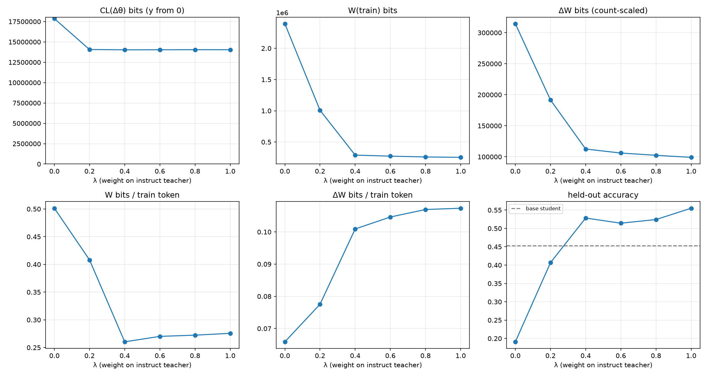
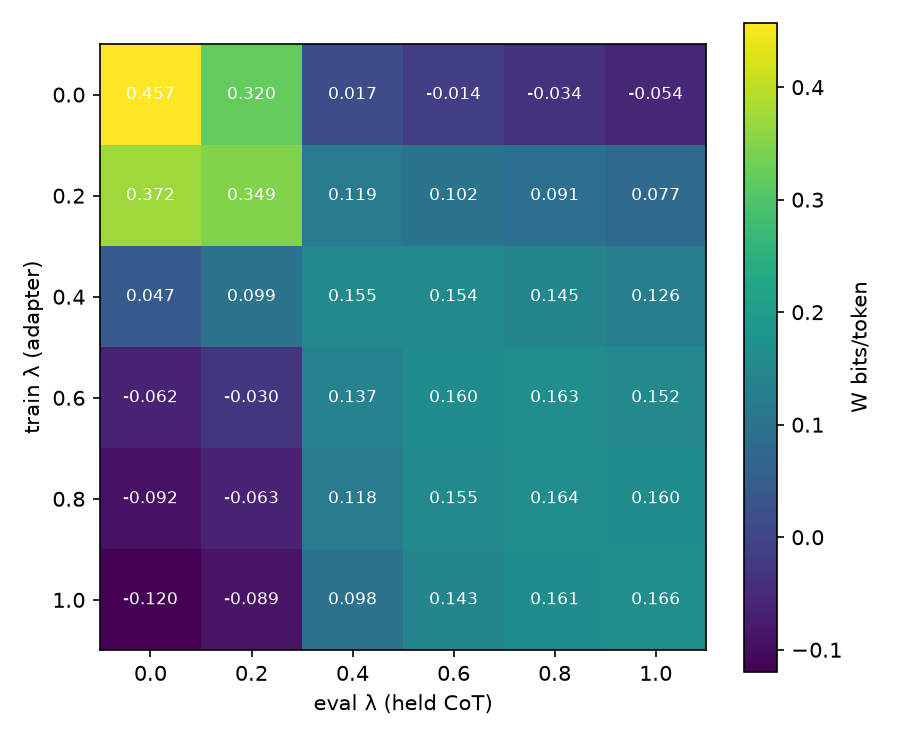

# λ sweep: LoRA bits of CoT distillation

Teacher pair: DeepSeek-R1-Distill-Qwen-1.5B (λ=0, Long CoT) ↔ Qwen2.5-Math-1.5B-Instruct (λ=1, Short CoT); student: Qwen2.5-0.5B-Instruct + LoRA (r=16, all linear layers).
Shared problems: 2413 (train 2113, held 300). Base student accuracy: held 0.453, MATH-500 —.

## Teacher CoT pools

| λ | teacher acc | truncated | avg teacher tokens | avg student tokens (kept) | train tokens |
|---|---|---|---|---|---|
| 0.0 | 0.765 | 0.185 | 3,851 | 2,747 | 5,070,016 |
| 0.1 | 0.81 | 0.107 | 2,826 | 1,996 | 3,405,736 |
| 0.2 | 0.813 | 0.071 | 2,231 | 1,535 | 2,599,187 |
| 0.3 | 0.807 | 0.0425 | 1,532 | 970.16 | 1,541,154 |
| 0.4 | 0.799 | 0.0355 | 1,117 | 673.66 | 1,164,398 |
| 0.6 | 0.794 | 0.0597 | 1,114 | 573.46 | 1,058,062 |
| 0.8 | 0.823 | 0.00725 | 680.45 | 545.38 | 998,917 |
| 1.0 | 0.815 | 0.0005 | 579.82 | 510.73 | 963,232 |

## Per-λ results (mean ± std over seeds)

| λ | seeds | held-out acc | MATH-500 acc | train tokens | dataset bits H | CL(Δθ) bits | step c* | CL bits/param | W(train) bits | W(held) bits | ΔW bits | ΔW token-scaled | W bits/token | ΔW bits/token | W/H |
|---|---|---|---|---|---|---|---|---|---|---|---|---|---|---|---|
| 0.0 | 1 | 0.191 | — | 4,773,183 | 5,789,480 | 17,858,484 | 1.50 | 1.58 | 2,392,947 | 295,105 | 314,421 | 209,374 | 0.501 | 0.0659 | 0.413 |
| 0.2 | 1 | 0.407 | — | 2,470,271 | 2,050,107 | 14,063,116 | 2.00 | 1.25 | 1,008,107 | 115,935 | 191,538 | 146,999 | 0.408 | 0.0775 | 0.492 |
| 0.4 | 1 | 0.528 | — | 1,114,976 | 552,531 | 14,028,969 | 2.00 | 1.24 | 290,266 | 25,237 | 112,517 | 117,219 | 0.26 | 0.101 | 0.525 |
| 0.6 | 1 | 0.514 | — | 1,013,429 | 472,663 | 14,035,245 | 2.00 | 1.25 | 273,782 | 23,817 | 106,031 | 111,332 | 0.27 | 0.105 | 0.579 |
| 0.8 | 1 | 0.524 | — | 957,318 | 433,557 | 14,040,999 | 2.00 | 1.25 | 260,732 | 22,481 | 102,389 | 103,817 | 0.272 | 0.107 | 0.601 |
| 1.0 | 1 | 0.555 | — | 923,070 | 420,268 | 14,036,883 | 2.00 | 1.25 | 254,474 | 22,061 | 99,092 | 101,008 | 0.276 | 0.107 | 0.606 |

## Cross-λ W (bits/token, seed 0): adapter trained on row λ, measured on column λ's held CoT

| train λ \ eval λ | 0.0 | 0.2 | 0.4 | 0.6 | 0.8 | 1.0 |
|---|---|---|---|---|---|---|
| 0.0 | 0.457 | 0.32 | 0.0171 | -0.0137 | -0.0344 | -0.0541 |
| 0.2 | 0.372 | 0.349 | 0.119 | 0.102 | 0.0912 | 0.0766 |
| 0.4 | 0.0469 | 0.099 | 0.155 | 0.154 | 0.145 | 0.126 |
| 0.6 | -0.0622 | -0.0297 | 0.137 | 0.16 | 0.163 | 0.152 |
| 0.8 | -0.0924 | -0.0625 | 0.118 | 0.155 | 0.164 | 0.16 |
| 1.0 | -0.12 | -0.0891 | 0.0981 | 0.143 | 0.161 | 0.166 |

